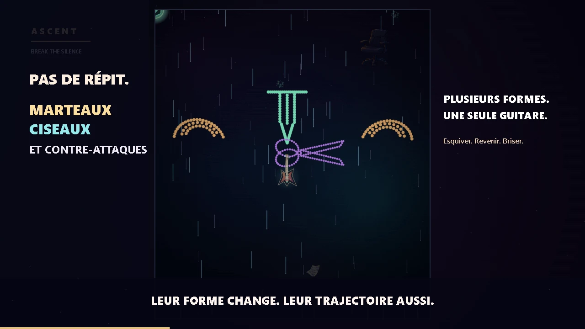
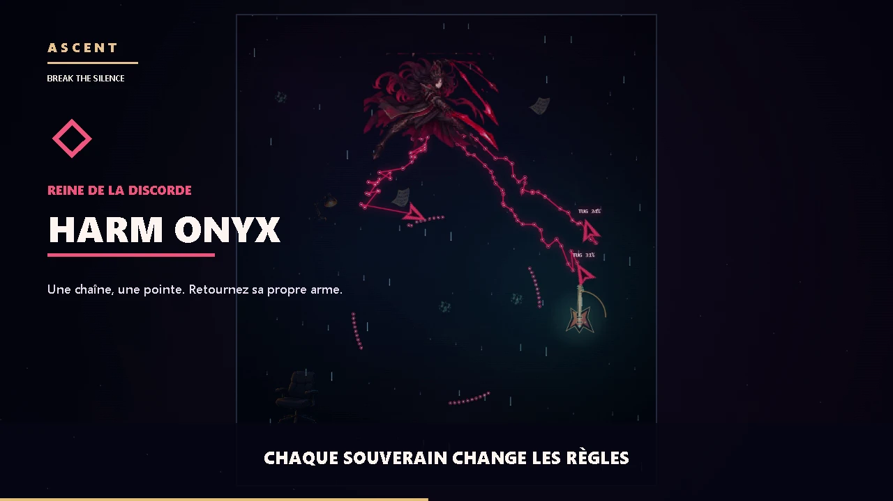
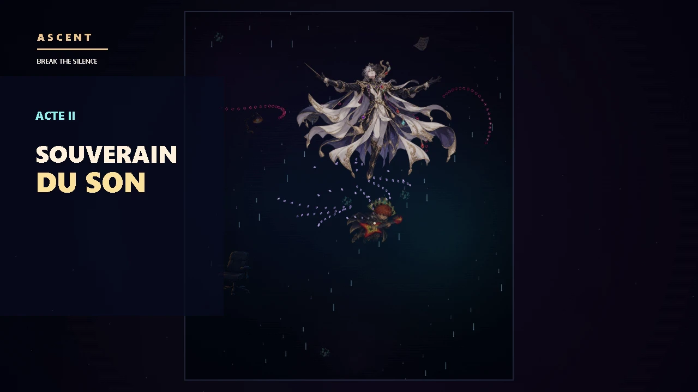

<div align="center">

# ⚡ ASCENT

### BREAK THE SILENCE · Un jeu d'action 2D guidé par le steering behaviour

**Une mélodie maudite. Un guitariste enlevé. Une guitare qui refuse de l'abandonner.**

[**▶ Jouer maintenant**](https://omar-tarrouzi.github.io/Projet-IA-r-active-break-the-silence/) · [Voir la démo commentée](https://omar-tarrouzi.github.io/Projet-IA-r-active-break-the-silence/?demo=1) · [Comment jouer](#comment-jouer) · [Algorithmes](#les-steering-behaviours-en-action)

*Projet de Master IA2 UNICA · IA réactive · Jouable dans le navigateur*

</div>



> **Le pitch.** Un soir, un guitariste joue une sonate interdite dans sa chambre. Une lumière déchire le ciel et des puissances l'emportent. Sa guitare prend vie et part à sa recherche, armée du pouvoir du ~~rock~~ **steering behaviour**.

Montez à travers des essaims qui s'assemblent en marteaux, ciseaux, shurikens et autres armes. Leurs points ne suivent pas une animation figée : ils cherchent leur place, se coordonnent, attaquent et se dispersent sous vos ondes soniques. Les rencontres culminent avec quatre souverains, puis la Sonate interdite.

## Jouer en deux clics

1. Ouvrez **[ASCENT sur GitHub Pages](https://omar-tarrouzi.github.io/Projet-IA-r-active-break-the-silence/)**.
2. Choisissez l'une des **trois façons de jouer** sur l'écran d'accueil.
3. Suivez le court tutoriel guidé. Le bouton **HOW TO PLAY** permet de le revoir pendant la partie.

| Mode | Déplacement | Attaque |
| --- | --- | --- |
| **Souris / tactile** | Pointez ou glissez vers la destination. | Maintenez le clic gauche ou le doigt, puis relâchez. |
| **Voix + souris** | Pointez avec la souris ou le doigt. | Un claquement bref lance une onde **MID** ; un son tenu charge **HIGH**, libéré quand il s'arrête. |
| **Main devant la caméra** | Déplacez la paume dans l'image. | Pincez pouce et index pour charger ; séparez-les pour tirer. |

La **souris et le tactile restent disponibles** si le micro ou la caméra ne fonctionne pas. Le navigateur demandera votre autorisation pour utiliser ces appareils. Le suivi de la main charge MediaPipe au premier usage : ce mode nécessite aussi une connexion Internet.

### Commandes utiles

| Action | Commande |
| --- | --- |
| Changer de fréquence | **1** = LOW, **2** = MID, **3** = HIGH ; boutons à l'écran ou molette de la souris |
| Dash pour esquiver | **Espace** ou **clic droit** ; bouton **DASH** sur mobile |
| Activer / couper le micro | Bouton **ENABLE MICROPHONE** ou **M** |
| Pause / reprise | **P** ou **Échap** |
| Recommencer | **R** |

**LOW** disperse autour de vous, **MID** frappe en cône, **HIGH** perce en ligne. Regardez la couleur, la forme et l'annonce de l'attaque : esquivez après le verrouillage, puis ripostez pendant l'ouverture. Les bonus de **vie**, de **volume** et d'**harmonisation** flottent vers la guitare lorsqu'elle s'en approche. Si les claquements sont mal détectés, ajustez **SENSITIVITY** dans l'interface.

## Ce qui vous attend



Chaque souverain impose une lecture différente du combat :

| Altitude | Souverain | À observer |
| --- | --- | --- |
| **1 000 m** | **Vesper · le silence** | Son essaim façonne un trône, une main, des missiles et des anneaux à ouverture mobile. Brisez sa formation, exploitez les fenêtres d'attaque et empêchez son rappel. |
| **2 000 m** | **Harm Onyx · la discorde** | Ses fléchettes rouges entraînent des chaînes. Esquivez la pointe, détruisez les maillons ou chargez près d'elle pour la lui renvoyer. |
| **3 000 m** | **Nova · l'écho** | Le feu bleu et les projectiles reprennent votre fréquence : reconnaissez-la et renvoyez l'écho avec la bonne onde. |
| **4 000 m** | **Cadence · la mesure** | Ses losanges et son métronome récompensent un relâchement sur le bon battement. |

<details>
<summary><strong>⚠ Révéler le dernier acte (spoiler)</strong></summary>

À **4 400 m**, la Sonate interdite mène à **Orpheus**. La guitare est brisée, le guitariste se libère, puis les pouvoirs gagnés auprès des souverains les réunissent pour un second acte jouable. L'épilogue révèle Orpheus et Eurydice.



</details>

Vous pouvez aussi ouvrir **Practice a Ruler** depuis le menu pour vous entraîner, ou lancer la **[démo autonome en français](https://omar-tarrouzi.github.io/Projet-IA-r-active-break-the-silence/?demo=1)** : le jeu se pilote seul et commente les mécaniques pour une présentation.

## Les steering behaviours en action

Le mouvement suit le modèle de Craig Reynolds : **force = vitesse désirée − vitesse actuelle**, limitée par `maxForce`, appliquée avec `applyForce()`. L'intégration de la locomotion reste dans le `Vehicle` du cours, [`vehicle.js`](vehicle.js), conservé tel quel. Les fonctions spécialisées sont dans [`behaviors/`](behaviors/) ; les contrôleurs composent leurs forces selon la situation.

| Algorithme / technique | Ce que l'on voit | Où regarder dans le code |
| --- | --- | --- |
| **Seek** · attraction directe | Notes à l'attaque et formations qui quittent l'écran | [`Note.js`](Note.js), [`FormationController.js`](systems/FormationController.js) |
| **Arrive** · ralentissement à l'approche | Guitare qui rejoint le pointeur ; points qui se posent dans une forme ; boss qui se replacent | [`Guitar.js`](Guitar.js), [`SwarmPoint.js`](SwarmPoint.js), [`sonata.js`](behaviors/sonata.js) |
| **Pursue** · interception prédictive | Notes qui poursuivent une cible mobile ; ancrages qui anticipent la guitare | [`Note.js`](Note.js), [`FormationController.js`](systems/FormationController.js) |
| **Evade / Flee** · fuite | Essaim qui s'écarte de la menace et se disperse sous l'onde | [`SwarmPoint.js`](SwarmPoint.js), [`flee.js`](behaviors/flee.js), [`blast.js`](behaviors/blast.js) |
| **Wander** · errance contrôlée | Flottement des bonus et mouvement des particules libres | [`Pickup.js`](Pickup.js), [`SwarmPoint.js`](SwarmPoint.js) |
| **Séparation + alignement + cohésion** · flocking | Particules qui gardent leur espace tout en restant une nuée | [`flocking.js`](behaviors/flocking.js), [`SpatialGrid.js`](systems/SpatialGrid.js) |
| **Boundaries / containment** · confinement | Freinage et guidage avant les bords de l'arène | [`boundaries.js`](behaviors/boundaries.js), [`velocity.js`](behaviors/velocity.js) |
| **Formation steering** · places mobiles | Marteaux, ciseaux, chaînes, trône et anneaux construits point par point | [`formation.js`](behaviors/formation.js), [`FormationController.js`](systems/FormationController.js) |
| **Orbit slotting** · répartition circulaire | Notes alliées en orbite et figures en anneau | [`notes.js`](behaviors/notes.js), [`Note.js`](Note.js) |
| **Redirection à virage limité** | Formes qui dépassent la guitare puis recourbent leur trajectoire | [`redirect.js`](behaviors/redirect.js), [`FormationController.js`](systems/FormationController.js) |
| **Guidage des projectiles de Cadence** | Losanges qui verrouillent une cible puis se réorientent avec un virage borné | [`diamond.js`](behaviors/diamond.js), [`CadenceDiamond.js`](CadenceDiamond.js) |
| **Attraction magnétique** | Bonus qui accélèrent vers la guitare proche | [`pickups.js`](behaviors/pickups.js), [`Pickup.js`](Pickup.js) |
| **Impulsion sonique / knockback** | Points projetés hors d'une construction après une onde | [`blast.js`](behaviors/blast.js), [`sketch.js`](sketch.js) |

La géométrie des formes et des orbites fournit des **cibles mobiles** ; ce sont ensuite les forces de steering qui y conduisent chaque `Vehicle`. La [grille spatiale](systems/SpatialGrid.js) limite le nombre de voisins à examiner, pour garder les essaims fluides.

## Lancer le projet localement

Depuis la racine du dépôt, avec Python 3 :

```sh
python -m http.server 8765
```

Ouvrez **[http://127.0.0.1:8765/](http://127.0.0.1:8765/)**. Le jeu utilise p5.js et ses ressources visuelles locales ; la musique et les effets sont synthétisés dans le navigateur. La caméra requiert le téléchargement du module MediaPipe au premier lancement. En local, `localhost` permet les demandes de micro et caméra ; sur le site publié, GitHub Pages fournit HTTPS.

**Bonne ascension. Faites du bruit.** 🎸

